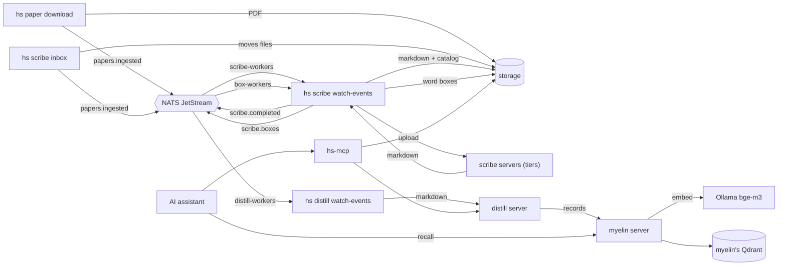

# Architecture

home-still is a few programs that share one storage root, one configuration
file and one event bus. This page explains how they fit together and why.
Ports, endpoints and keys are listed in the
[reference](../reference/services-and-ports.md).

## Components and data flow



**Storage** holds every document and its derivatives under one root:
sources under `papers/`, markdown under `markdown/`, catalog entries under
`catalog/`, word boxes under `boxes/`. The root is either a local directory
(which can be a network mount) or an S3-compatible bucket such as Garage.
Every program reads and writes through the same storage interface, so a
document is the same object wherever it is seen from.

**The catalog** is one YAML entry per document, keyed by its stem. It records
the document's metadata, which backend converted it and when, its page
offsets, whether it was embedded, and any failure stamp. Status counts,
recovery commands and the MCP tools all read it.

**The event bus** is NATS with JetStream. Storing a source publishes
`papers.ingested`; storing its markdown publishes `scribe.completed` and, for
a PDF, `scribe.boxes`. Each kind of work is read through one *durable pull
consumer* (`scribe-workers`, `box-workers`, `distill-workers`). Every watcher
of a kind shares that consumer, so the broker splits the messages between
them, and it remembers which are
unacknowledged. A watcher acknowledges a message only when the work is
stored; a message whose watcher dies, or that takes longer than the
acknowledgement wait, is delivered again. Delivery is therefore
*at least once*: work is never silently lost, and every handler is written so
that doing a document twice gives the same result.

The event bus is required. The watchers, the inbox, `hs pipeline`,
`hs paper download` and `hs-mcp` refuse to start without an `events:`
section, rather than storing documents that nothing will ever process.

**The scribe servers** convert one document per request and keep no state:
they read the uploaded bytes and return markdown. The watcher that sent the
request writes the result and the catalog entry. A scribe host therefore
needs no storage access, and you add conversion capacity by starting another
server and listing it.

**Word boxes** are a second product of a PDF: where each word sits on its
page, kept as one sidecar object per document. They are what lets a quotation
be found and highlighted on the page it came from. The scribe watcher asks a
scribe server for them once the markdown is stored, on a queue of its own, so
a slow scan never holds up a conversion and a missing sidecar can be queued
again without converting anything.

**The distill server** chunks markdown and writes the chunks as records into
a named *store* of a myelin server, over MCP. It does not embed anything
itself. It also answers searches by asking myelin. At start-up it defines
every store in myelin and refuses to start when myelin does not answer or
when Ollama does not hold the embedding model on the GPU.

**myelin** is a separate project (`github.com/home-still/myelin`). It embeds
each chunk with Ollama's `bge-m3` on the GPU, keeps the vectors in a Qdrant
of its own, fuses keyword and vector candidates and reranks them with a
cross-encoder. home-still no longer runs or manages a Qdrant. myelin serves
two MCP surfaces: the full one, used by the distill server, and an agent
surface, where an assistant searches. See
[set up myelin](../tutorials/home-cloud-cluster.md#8-set-up-myelin-on-the-gpu-host).

**The MCP server** (`hs-mcp`) reads storage, the catalog and the distill
server, and offers them as tools to an AI assistant: it reads, cites and
acquires, while search is the `myelin` server's. `hs status` asks
it for the pipeline's numbers, so the dashboard and an assistant always agree.

## The scribe tier chain

`scribe.servers` is an ordered list. Each entry names a URL, a backend and a
concurrency:

```yaml
scribe:
  servers:
    - url: http://<gpu-host>:7435
      backend: olmocr
      concurrency: 2
    - url: http://<gpu-host>:7433
      backend: glm_ocr
      concurrency: 4
    - url: http://<scribe-host>:7433
      backend: glm_ocr
      concurrency: 8
```

Entries with the same backend form one **tier**, in the order each backend
first appears. A document goes to the first tier, to whichever of its servers
reports the most free slots. The tier's concurrency is the sum of its
entries', so a heavy model gets few conversions at a time however many slots
its host advertises.

If the tier fails the document for a reason a *different* model might not
share (the model looped, its stream died, it left regions unread, olmocr
lost pages), the document escalates to the next tier. If the failure is in
the document itself (an HTML page saved as `.pdf`, a broken PDF), no tier can
help, and it is stamped as a bad source at once. A document that escapes
every tier is stamped with the last reason. The stamp's kind decides what can
bring it back; see
[conversion failure reasons](../reference/status-dashboard.md#conversion-failure-reasons).

A failure that says nothing about the document (the server was unreachable
or answered with an error) also moves on to the next tier, which runs on a
different process and often a different host. If every tier fails that way,
the message goes back to the broker unstamped and is delivered again later.

## The gateway and trust

Only one program faces the internet: `hs-gateway`, reached through a
Cloudflare tunnel so your router opens no port. Everything behind it trusts
the gateway, not the caller.

- **Devices** enroll with a one-time code created on the gateway host. The
  code fixes the device's name and its **scopes**: `scribe`, `distill`,
  `mcp`, `memory`. A device gets a refresh token and trades it for short-lived access
  tokens; each proxied request needs an access token whose scopes cover the
  service.
- **Claude Desktop** uses OAuth 2.1 with PKCE against the same gateway; the
  user types an enrollment code into the gateway's browser form, and the
  resulting tokens carry that code's scopes.
- **Backends** never see a user's token. The gateway replaces it with
  `HS_BACKEND_TOKEN`, a secret shared by the gateway and every backend host,
  and each backend refuses requests without it. A backend reachable on your
  network still cannot be used by something that does not hold the secret.
- **Documents** are the exception. A link to a document carries its own
  signature, expiry and subject in its query string, because a browser cannot
  attach a header to a link someone clicks. The gateway forwards `/docs/*`
  without a bearer token, and the docs service checks the signature. The same
  link works on the LAN and through the gateway, checked by the same code.
- **Administration** (creating codes, revoking devices) uses a separate admin
  key and works only from the gateway host itself: a request that came
  through any proxy is refused.

Revoking a device puts its name on one revocation list. The gateway refuses
the device's tokens, and the docs service, which reads the same list when it
starts, refuses every link whose subject is on it.

## The crates

| Crate | Builds | Role |
|---|---|---|
| `crates/hs` | `hs` | The command line: every command, the service installers, `hs status`, `hs upgrade`, and the docs service. |
| `crates/hs-scribe` | `hs-scribe-server`, and a client library | Conversion: the scribe server and the client the watcher uses. |
| `crates/hs-distill` | `hs-distill-server`, and a client library | Chunking, and writing and searching records in myelin. |
| `crates/hs-mcp` | `hs-mcp` | The MCP server. |
| `crates/hs-gateway` | `hs-gateway` | The authenticating reverse proxy. |
| `crates/openalex-ingest` | library | Loads an OpenAlex snapshot into a local DuckDB catalog. |
| `paper` | library | Provider search, ranking and downloading, used by `hs` and `hs-mcp`. |
| `personal` | library | The personal-documents store. |
| `hs-common` | library | Storage, the event bus, the catalog, configuration, authentication, signed links, status and shared helpers. |

## One path, and failing loudly

Every operation has exactly one way of happening. When it cannot produce a
correct result, it stops with an error that names the cause and the setting
or command that fixes it. It does not fall back to a second, weaker path:
no CPU embedding when CUDA fails, no folder watcher when the event bus is
down, no default for a missing setting, no partial document stored in place
of a failed one. A fallback hides the failure and produces results nobody can
explain; an error can be fixed.

You see this throughout: servers refuse to start without their secret,
libpdfium or a reachable dependency; a configuration key that does not exist
is reported with the valid keys; a conversion with holes is rejected instead
of stored; and an unknown count is shown as `?`, never as zero.

## Sharing one GPU

A home cluster usually has one GPU, shared by the conversion model, the
embedding model and anything else you run on it.

**The scribe server gates on free VRAM.** A scribe server running the olmocr
converter loads its model through llama-swap on a shared card. Before it
admits work, it checks whether llama-swap has the model loaded or the card
has room to load it (`HS_SCRIBE_VRAM_HEADROOM_MB`). When it has neither, `/health` and
`/readiness` refuse work, and the dispatcher sends documents elsewhere or
waits, instead of feeding a backend that can only time out. The refusal is a
diagnosis, shown on the dashboard:

```text
backend unavailable: 12.9 GiB free, needs 13.2 GiB; held by pid=4242 7534MB hs-distill-server; …
```

It names the free memory, the headroom, and every process holding the card,
so you can see which tenant to stop or move.

**The embedding model must be on the GPU.** Embedding is done by Ollama's
`bge-m3` behind myelin. The distill server asks Ollama where that model is
resident, and refuses to start, and reports itself not ready, unless it is
fully on the GPU. It never accepts a CPU or partly offloaded model. When
Ollama does not hold the model on the GPU, fix Ollama's CUDA or free VRAM;
see [troubleshoot](../how-to/troubleshoot.md).
